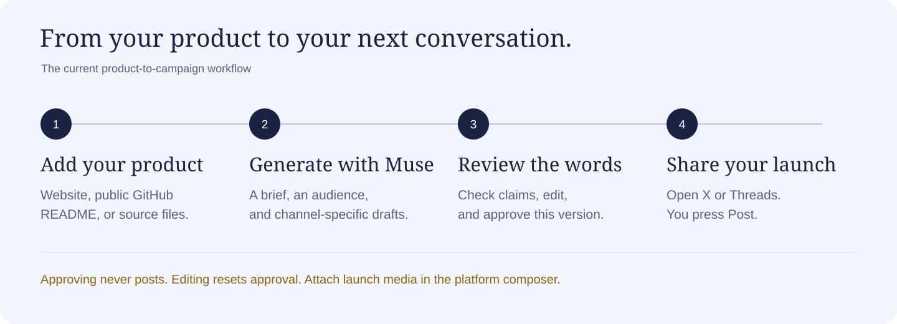
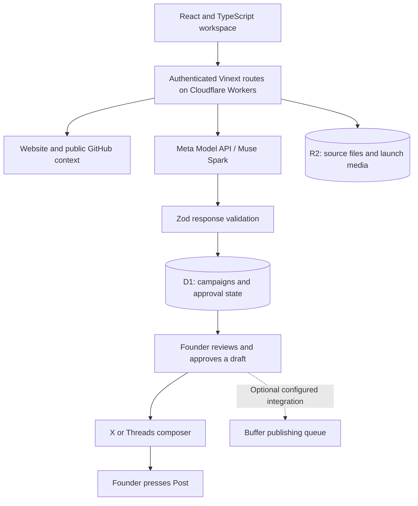

# Reef

<p align="center">
  
</p>

<p align="center">
  <strong>A Muse-powered launch workspace for technical founders.</strong><br />
  Turn existing product material into a campaign you can review, refine, and share.
</p>

<p align="center">
  <a href="#how-it-works">How it works</a> ·
  <a href="#getting-started">Getting started</a> ·
  <a href="#architecture">Architecture</a> ·
  <a href="submission/DEMO_SLIDES.html">Demo slides</a> ·
  <a href="submission/JUDGE_GUIDE.md">Judge guide</a>
</p>

## Overview

Building a product and explaining it are different jobs. Reef helps independent developers and small software teams turn their website, public GitHub README, and source documents into a clear product story and launch drafts.

Muse Spark provides the synthesis and writing through a direct server-side Meta Model API integration. Founders inspect the result, check suggested evidence, and approve the words they want to share. Reef then opens the approved text in X or Threads, where the founder completes the post.

**Status:** Hackathon prototype built for the Meta Global AI Developer Hackathon, under the **Build for Your World** theme. Connected publishing and acquisition measurement remain areas for future development.

## How it works



*Brand and workflow illustrations use the website’s sky palette. They are not application screenshots.*

1. **Bring your product.** Add a website, public GitHub repository, description, or source files. Choose a goal such as getting feedback or finding early users.
2. **Create a launch plan.** Muse proposes a product brief, an audience, claims with source references, and drafts tailored to each channel.
3. **Make it your own.** Review the brief, inspect suggested evidence, preview posts, and edit the wording. Approve the exact version you want to use.
4. **Share deliberately.** Open X or Threads with approved text prefilled. Sign in on the destination platform and press Post yourself. Download campaign media to attach manually.

## Features

| Capability | Available today |
| --- | --- |
| Product context | Website text, public GitHub metadata and README, source PDFs, images, and text |
| Campaign generation | Structured product brief, audience suggestions, source references, and channel-specific drafts |
| Draft review | Editable content, previews, and version-specific approval |
| Social handoff | Native X and Threads text composers; optional LinkedIn drafts |
| Launch assets | Best-effort website screenshots, private image/video storage, previews, and downloads |
| Workspace | Saved campaigns, activity, campaign export, and a clearly labeled sample |
| Platform-specific guidance | Human-written, manual Hacker News submission tasks |
| Interface | Responsive sky theme, animated ASCII background, and reduced-motion support |

### Publishing and review

- **Approval does not publish.** The default workflow hands text to a platform composer. Reef does not need an in-app social account connection for this flow.
- **Edits reset approval.** Approval belongs to a particular draft version.
- **Source references are suggestions.** Founders must verify generated claims before sharing them.
- **Samples stay samples.** Sample campaigns cannot be approved for publishing.
- **Media needs a manual attachment.** Compose links carry text. Uploaded videos are stored launch assets, not transcribed or analyzed video inputs.

An optional, owner-scoped Buffer integration can submit approved posts to a connected channel’s queue. It requires separate server configuration and is not needed for X/Threads compose handoff. Queue acceptance is distinct from confirmed publication.

## Architecture



| Layer | Technology |
| --- | --- |
| Interface | React 19, TypeScript, Tailwind CSS, custom ASCII sky |
| Application | Vinext with Next-compatible routes, Cloudflare Workers |
| AI | Meta Model API Responses endpoint, Muse Spark |
| Persistence | Cloudflare D1, Drizzle migrations, Cloudflare R2 |
| Validation | Zod schemas and application domain rules |
| Source and media integrations | GitHub API/README ingestion, Microlink page capture |
| Distribution | X/Threads web composers, optional Buffer GraphQL API |

Model credentials remain on the server. Campaigns and uploads are scoped to authenticated users. The optional Buffer path uses conditional database updates to guard against concurrent duplicate submissions and preserves uncertain outcomes for reconciliation.

## Getting started

### Prerequisites

- **Node.js 24 recommended** for the test suite. The package requires Node.js `>=22.13.0`.
- npm and a local checkout of this repository.
- A Meta Model API key for real campaign generation.

### Install and initialize

Run these commands from the repository root:

```sh
npm ci
npm run build
```

Apply the initial local database migration once:

```sh
node --import ./scripts/sites-env.mjs ./node_modules/wrangler/bin/wrangler.js d1 execute DB --local --config dist/server/wrangler.json --persist-to .wrangler/state --file drizzle/0000_glossy_vulcan.sql
```

Create an ignored `.dev.vars` file with your server credentials:

```dotenv
MODEL_API_KEY=your_meta_model_api_key
MUSE_MODEL=muse-spark-1.3
```

Start the application:

```sh
npm run dev
```

Open the address printed by the server. For local development, visit `/signin-with-chatgpt?return_to=/` on that address to use the starter’s simulated sign-in. Hosted authentication is handled by Sites. See [DEVELOPMENT.md](DEVELOPMENT.md) for runtime, storage, and hosting details.

### Configuration

Use `.dev.vars` locally or the hosted runtime’s secret settings. Never commit credentials or expose them in browser code.

| Variable | Required | Purpose |
| --- | --- | --- |
| `MODEL_API_KEY` | For live generation | Meta Model API credential |
| `MUSE_MODEL` | No | Model override; defaults to `muse-spark-1.3` |
| `GITHUB_TOKEN` | No | Public-read GitHub access with higher API rate limits |
| `SCREENSHOT_API_KEY` | No | Microlink Pro credential; otherwise capture attempts use the public endpoint |
| `BUFFER_API_KEY` | Only for Buffer | API publishing credential |
| `BUFFER_OWNER_ID` | Only for Buffer | Authenticated Reef user ID authorized to use that credential |

**Buffer is optional.** Leave both Buffer variables unset when using the normal X/Threads composer workflow.

## Development

```sh
npm run typecheck  # TypeScript checks
npm test           # Domain and in-process API integration tests
npm run build      # Production build
```

The test suite covers domain and URL boundaries, authentication, campaign persistence, draft editing, stale approvals, upload ownership, and optional Buffer submission behavior. External providers are mocked in integration tests; these checks do not establish live-provider or browser verification.

### Repository structure

```text
app/                 Application pages and API routes
components/          Workspace interface
lib/                 Domain logic, source ingestion, media, and ASCII rendering
db/                  Database bindings and schema
drizzle/             Database migrations
tests/               Domain and API integration tests
docs/images/         README illustrations
submission/          Submission copy, demo deck, and judge materials
```

## Current scope and roadmap

Reef currently supports a focused product-to-campaign workflow. It does not yet provide self-service social OAuth, autonomous publishing across all platforms, raw-video understanding, generated pitch decks, or conversion tracking.

Planned directions:

- Social account connections and reliable background publishing.
- Background generation and clearer recovery from provider failures.
- Campaign attribution and measurement of acquired users.
- A reusable MCP interface for launching from other tools.

The product’s value hypothesis is reduced effort between a working product and its first reviewed campaign. Acquisition performance and time savings have not yet been measured.

## Demo and hackathon materials

| Resource | Contents |
| --- | --- |
| [HTML demo deck](submission/DEMO_SLIDES.html) | Seven slides with speaker notes and sourced competitor pricing; download and open locally |
| [Demo script](submission/DEMO_SCRIPT.md) | Suggested recording sequence and preparation |
| [Judge guide](submission/JUDGE_GUIDE.md) | What to inspect and how to evaluate the prototype |
| [Submission answers](submission/SUBMISSION.md) | Project narrative and technical implementation |
| [Readiness checklist](submission/READINESS.md) | Remaining verification and submission assets |

The HTML deck supports arrow-key navigation, **N** for notes, and **F** for fullscreen. Submission documents record the revision reviewed when they were prepared; they are not a live deployment status page.

## Acknowledgments

Reef uses Meta Model API, React, Vinext, Cloudflare Workers/D1/R2, Drizzle, and Zod. GitHub supplies repository context, Microlink supplies page capture, and Buffer supports the optional publishing path.

The project retains [ASCII Sharks](https://github.com/stackedlol/ascii-sharks) source and its [MIT license](lib/ascii-sharks/LICENSE). The current interface uses a custom ASCII sky. Hosting infrastructure derives from the Sites/Vinext starter. Development included AI coding assistance.
